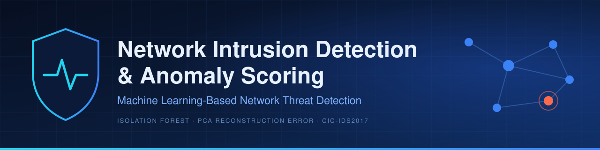
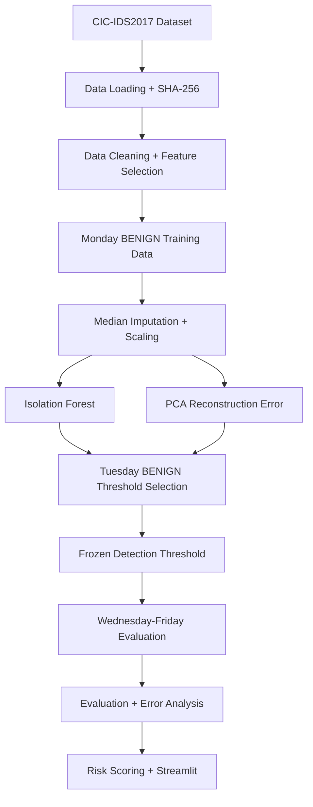

<p align="center">
  
</p>

**Unsupervised anomaly detection on real network-flow data (CIC-IDS2017). Models learn only what *benign* traffic looks like, thresholds are frozen on held-out benign data, and everything is evaluated on later capture days the models never saw.**

**Language** &nbsp;   
**Machine learning** &nbsp;    
**Dashboard** &nbsp;   
**Development** &nbsp;   

<!-- DATA PROCESSING badges: add ONLY after confirming in requirements.txt / imports, e.g.


Check:  grep -iE "pandas|numpy" requirements.txt
-->

[Overview](#overview) · [Dataset](#dataset) · [Architecture](#architecture) · [Methodology](#methodology) · [Experimental design](#experimental-design) · [Design decisions](#design-decisions) · [Quickstart](#quickstart) · [Limitations](#limitations) · [Roadmap](#roadmap)

---

## Overview

Most intrusion detection demos on CIC-IDS2017 shuffle network flows and report inflated scores. This project asks a harder question: **if a model only learns what normal traffic looks like, how well can it flag attacks it has never seen, and how honestly can the results be reported?**

Three approaches are implemented:

- **Isolation Forest:** primary benign-only anomaly detector
- **PCA reconstruction error:** unsupervised baseline
- **Random Forest:** separate supervised reference model

The focus is on reproducible preprocessing, leakage prevention, threshold selection, per-attack evaluation, risk scoring and diagnostic explanations. Configuration is in `configs/config.yaml`, and unit tests cover the pipeline components.

---

## Dataset

**CIC-IDS2017** (Canadian Institute for Cybersecurity): labeled network flows from five weekdays of benign and malicious traffic. [Official source](https://www.unb.ca/cic/datasets/ids-2017.html).

| Day | Attack content | Role in this project |
|---|---|---|
| Monday | Benign only | Train preprocessing and unsupervised models |
| Tuesday | FTP-Patator, SSH-Patator and benign | Benign rows select thresholds; labeled rows train the supervised reference |
| Wednesday | DoS variants, Heartbleed | Final evaluation |
| Thursday | Web attacks and infiltration | Final evaluation |
| Friday | Botnet, PortScan and DDoS | Final evaluation |

Download the original weekday CSVs and place them in `data/raw/`:

```text
data/raw/
├── Monday-WorkingHours.pcap_ISCX.csv
├── Tuesday-WorkingHours.pcap_ISCX.csv
├── Wednesday-workingHours.pcap_ISCX.csv
├── Thursday-WorkingHours-Morning-WebAttacks.pcap_ISCX.csv
├── Thursday-WorkingHours-Afternoon-Infilteration.pcap_ISCX.csv
├── Friday-WorkingHours-Morning.pcap_ISCX.csv
├── Friday-WorkingHours-Afternoon-PortScan.pcap_ISCX.csv
└── Friday-WorkingHours-Afternoon-DDos.pcap_ISCX.csv
```

Use the exact filenames from your download and set them in `configs/config.yaml`.

**Data integrity**
- The loader records a SHA-256 hash of every original CSV
- Training stops if the real dataset files are missing
- Synthetic data is used only for unit tests and never for reported performance

---

## Architecture



---

## Methodology

**1. Isolation Forest (primary).** Trained only on Monday BENIGN traffic. It isolates unusual flows with random tree splits, so a shorter average path means more anomalous. No attack labels are needed.

**2. PCA reconstruction error (unsupervised baseline).** Learns a lower-dimensional representation of benign traffic, reconstructs each flow from it and uses the reconstruction error as an anomaly signal. It's a deliberately simple comparison point for Isolation Forest.

**3. Random Forest (supervised reference).** Trained separately on labeled Monday and Tuesday data. Since the only attacks in that training data are the Tuesday ones, it is a reference point, **not** an upper bound, and not an apples-to-apples comparison with the unsupervised models.

| Output | Meaning | Limitation |
|---|---|---|
| Anomaly score | How unusual a flow is relative to benign traffic | Not a calibrated attack probability |
| Risk score | Risk-oriented rescaling of the anomaly score | Not a probability or a definitive verdict |
| Feature deviations | Features that deviate most from benign behaviour | Diagnostic only; not causal and not SHAP |

---

## Experimental design

A chronological, day-based split is used instead of shuffling flows.

| Partition | Purpose |
|---|---|
| Monday BENIGN | Fit imputation, scaling, Isolation Forest and PCA |
| Tuesday BENIGN | Select anomaly detection thresholds |
| Monday + Tuesday labeled | Train the supervised Random Forest |
| Wednesday–Friday | Final evaluation of the frozen unsupervised pipeline |

**Leakage controls**
- Imputation and scaling are fit on Monday BENIGN only
- Unsupervised models are trained on Monday BENIGN only
- Thresholds come from Tuesday BENIGN scores and are frozen before final evaluation
- Wednesday–Friday data is never used to fit preprocessing or choose thresholds
- Identifiers, timestamps, destination port and labels are excluded from model inputs

<!-- TODO: add one line stating the exact threshold rule from src/nids/threshold.py,
e.g. "Threshold = 99th percentile of Tuesday BENIGN scores." -->

### Results

Evaluation outputs, including overall metrics, per-attack recall and false-positive rate on held-out benign traffic, are in [`reports/model_card.md`](reports/model_card.md) and [`reports/error_analysis.md`](reports/error_analysis.md).

<!-- RESULTS TABLES: fill from reports/model_card.md, then uncomment and delete this note.

**Overall (Wednesday–Friday, frozen thresholds)**

| Model | Type | ROC-AUC | PR-AUC | Precision | Recall | F1 |
|---|---|---:|---:|---:|---:|---:|
| Isolation Forest | Unsupervised | | | | | |
| PCA reconstruction error | Unsupervised | | | | | |
| Random Forest | Supervised | | | | | |

**Per-attack recall**

| Attack category | Day | Recall |
|---|---|---:|
| DoS / DDoS | Wed / Fri | |
| PortScan | Fri | |
| Botnet | Fri | |
| Web attacks | Thu | |
| Infiltration | Thu | |

PR-AUC and per-attack recall matter more than accuracy here because attack data is heavily imbalanced. False-positive rate on held-out benign traffic shows the operational cost of a threshold.
-->

---

## Design decisions

| Decision | Reason |
|---|---|
| Unsupervised models trained on benign traffic only | Simulates detection when attack labels are unavailable |
| Chronological day-based split | Avoids leakage from shuffled flow-level partitions |
| Separate benign day for thresholds | Prevents choosing thresholds on final evaluation data |
| Drop destination port and timestamp | Reduces reliance on capture-specific shortcuts |
| Median imputation | Handles missing and invalid numerical values robustly |
| PCA baseline | Simple check on whether Isolation Forest adds value |
| Random Forest kept separate | Provides a supervised reference, not a like-for-like detector |
| SHA-256 file hashing | Ties results to the exact input files |

---

## Quickstart

```bash
git clone https://github.com/yash-2999/network-intrusion-detection-anomaly-scoring.git
cd network-intrusion-detection-anomaly-scoring

python -m venv .venv
source .venv/bin/activate          # Windows: .\.venv\Scripts\Activate.ps1
pip install -r requirements.txt
```

Place the dataset in `data/raw/` (see [Dataset](#dataset)), then follow [`RUN_GUIDE.md`](RUN_GUIDE.md) for the full training and evaluation sequence.

<!-- TODO: paste the real train/evaluate commands from RUN_GUIDE.md here -->

**Launch the app**

```bash
streamlit run app/streamlit_app.py
```

<!-- SCREENSHOTS: capture REAL images with scripts/capture_screenshots.py, then uncomment
### Screenshots

| | |
|---|---|
| <br>**Overview.** Main dashboard. | <br>**Detection results.** Flows flagged by the frozen threshold. |
| <br>**Model comparison.** Isolation Forest vs PCA vs supervised reference. | <br>**Threat analysis.** Feature-deviation diagnostics for a flagged flow. |

Adjust captions to match what the app's pages actually show.
-->

**Run the tests** (synthetic fixtures; the full dataset is not needed)

```bash
pytest -v
```

Covered: data loading, preprocessing, dataset splitting, model behaviour, risk scoring and prediction.

---

## Limitations

This is an educational batch-flow research prototype, **not a production intrusion detection system**.

1. **Dataset:** CIC-IDS2017 is a laboratory capture and may not represent modern production traffic. It also has documented labeling and flow-extraction issues (Engelen et al., 2021).
2. **Capture conditions:** how the data was generated can influence behaviour and generalization.
3. **Day-based split:** chronological partitions reduce leakage but don't guarantee statistical independence.
4. **False positives:** unusual but legitimate traffic may be flagged.
5. **False negatives:** malicious traffic that resembles normal flows may go undetected.
6. **Calibration:** anomaly scores are rankings, not probabilities.
7. **Operations:** alerts need human investigation. There is no live packet capture or streaming ingestion.

---

## Roadmap

- [ ] Autoencoder baseline alongside PCA
- [ ] Per-attack-type threshold analysis
- [ ] Score calibration using validation data
- [ ] Evaluation on a second intrusion detection dataset
- [ ] Drift analysis across capture days
- [ ] Docker support for reproducible execution

---

<details>
<summary><b>Project structure</b></summary>

```text
network-intrusion-detection-anomaly-scoring/
├── app/                 Streamlit interface (streamlit_app.py)
├── assets/              banner.svg, screenshots/
├── configs/             config.yaml
├── data/                raw/ and processed/ (not committed)
├── models/              trained artifacts
├── notebooks/           01_network_traffic_eda.ipynb
├── reports/             model_card.md, error_analysis.md, figures/
├── scripts/             capture_screenshots.py
├── src/nids/
│   ├── config.py        configuration loading
│   ├── data_loader.py   CSV loading + SHA-256 recording
│   ├── preprocessing.py cleaning, imputation, scaling
│   ├── split.py         chronological day-based partitions
│   ├── models.py        Isolation Forest, PCA, Random Forest
│   ├── train.py         training entry point
│   ├── threshold.py     threshold selection
│   ├── evaluate.py      metrics
│   ├── risk_scoring.py  anomaly score to risk level
│   ├── explainability.py feature-deviation diagnostics
│   └── predict.py       inference
├── tests/               pytest suite
├── PROGRESS.md
├── RUN_GUIDE.md
└── requirements.txt
```

</details>

---

## Documentation

[Model card](reports/model_card.md) · [Error analysis](reports/error_analysis.md) · [Run guide](RUN_GUIDE.md) · [Progress log](PROGRESS.md)

## License

Distributed under the MIT License. See [LICENSE](LICENSE).

## References

- Sharafaldin, Lashkari, Ghorbani. *Toward Generating a New Intrusion Detection Dataset and Intrusion Traffic Characterization.* ICISSP 2018.
- Liu, Ting, Zhou. *Isolation Forest.* IEEE ICDM 2008.
- Engelen, Rimmer, Joosen. *Troubleshooting an Intrusion Detection Dataset: the CICIDS2017 Case Study.* IEEE S&P Workshops 2021.
