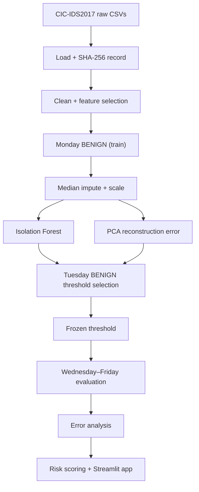

# 🛡️ Network Intrusion Detection & Anomaly Scoring

**Unsupervised anomaly detection on real network-flow data (CIC-IDS2017) — trained on benign traffic only, evaluated on later capture days with leakage controls.**


<!-- TODO: add a screenshot or GIF of the Streamlit app here -->
<!--  -->

---

## What this project does

Flags unusual network flows without needing attack labels at training time. An **Isolation Forest** is fit on benign Monday traffic only, a **PCA reconstruction-error** model acts as a second unsupervised baseline, and a **supervised Random Forest** is trained separately as a reference ceiling. Thresholds are chosen on held-out benign data, frozen, and then tested on Wednesday–Friday attacks the models never saw.

**Why it's built this way:** most IDS demos on CIC-IDS2017 shuffle rows and report inflated scores. This one uses a chronological day-based split, fits all preprocessing on training data only, and freezes thresholds before final evaluation.

---

## Results

> ⚠️ Replace the `–` values with your final numbers from `reports/model_card.md` before publishing. Don't leave placeholders live.

| Model | Type | ROC-AUC | PR-AUC | Recall @ frozen threshold | False-positive rate (Tuesday BENIGN) |
|---|---|---|---|---|---|
| Isolation Forest (primary) | Unsupervised | – | – | – | – |
| PCA reconstruction error | Unsupervised | – | – | – | – |
| Random Forest (reference) | Supervised | – | – | – | – |

Per-attack-type recall (DoS, DDoS, PortScan, web attacks, infiltration) is in [`reports/error_analysis.md`](reports/error_analysis.md).

---

## Experimental design

| Partition | Used for |
|---|---|
| Monday BENIGN | Fit imputer, scaler, Isolation Forest, PCA |
| Tuesday BENIGN | Select detection thresholds |
| Monday + Tuesday (labeled) | Train the separate supervised Random Forest |
| Wednesday–Friday | Final evaluation with frozen thresholds |

**Leakage controls**
- Imputation and scaling are fit on Monday BENIGN only
- Thresholds come from Tuesday BENIGN scores and are frozen before evaluation
- Wednesday–Friday data never touches fitting or threshold selection
- Identifiers, timestamp, destination port and labels are excluded from model inputs

---

## Pipeline



**Interpretation outputs**
- *Anomaly scores* rank flows by how unusual they are versus benign traffic. They are **not calibrated attack probabilities**.
- *Risk scores* are a risk-oriented rescaling of those outputs.
- *Feature-deviation diagnostics* show which features deviate most from benign behaviour. They are diagnostic only — not causal explanations and not SHAP values.

---

## Quickstart

```bash
git clone https://github.com/yash-2999/network-intrusion-detection-anomaly-scoring.git
cd network-intrusion-detection-anomaly-scoring

python -m venv .venv
source .venv/bin/activate        # Windows: .\.venv\Scripts\Activate.ps1
pip install -r requirements.txt
```

**Data:** download the CIC-IDS2017 weekday CSVs from the [official source](https://www.unb.ca/cic/datasets/ids-2017.html) into `data/raw/`. Training stops if they're missing — synthetic data is used for unit tests only, never for reported metrics.

**Run:** follow [`RUN_GUIDE.md`](RUN_GUIDE.md) for the exact training/evaluation order, then launch the app:

```bash
streamlit run app/streamlit_app.py
```

**Test:**

```bash
pytest -v
```

---

<details>
<summary><b>📁 Project structure</b></summary>

```text
├── app/            Streamlit interface
├── configs/        config.yaml
├── data/           raw/ and processed/ (not committed)
├── docs/           supporting documentation
├── models/         trained artifacts
├── notebooks/      01_network_traffic_eda.ipynb
├── reports/        model_card.md, error_analysis.md, figures/
├── src/nids/       config, data_loader, preprocessing, split, models,
│                   train, evaluate, threshold, risk_scoring,
│                   explainability, predict
└── tests/          unit tests for loader, preprocessing, split,
                    models, risk scoring, prediction
```

</details>

---

## Limitations

This is a batch-flow research prototype, not a production IDS.

- **Dataset:** CIC-IDS2017 is a lab capture and may not reflect modern production traffic. It also has documented labeling and flow-extraction issues (Engelen et al., 2021).
- **Split:** day-based chronological splits reduce leakage but don't guarantee statistical independence.
- **Errors:** unusual benign traffic can be flagged (false positives); some attacks resemble benign flows (false negatives).
- **Scores:** anomaly scores are rankings, not probabilities.
- **Operations:** alerts need human review; there is no streaming or real-time capture here.

---

## Documentation

[Model card](reports/model_card.md) · [Error analysis](reports/error_analysis.md) · [Run guide](RUN_GUIDE.md) · [Progress log](PROGRESS.md)

## License

MIT — see [LICENSE](LICENSE).
