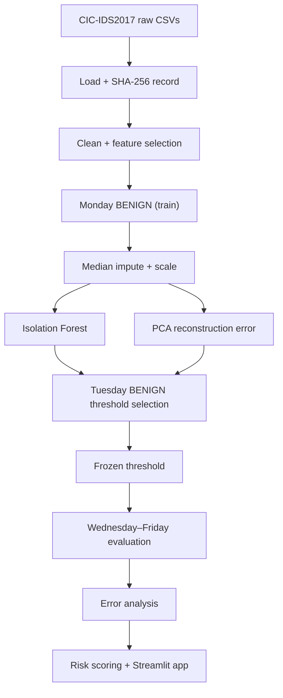

# 🛡️ Network Intrusion Detection & Anomaly Scoring

**Unsupervised anomaly detection on real network-flow data (CIC-IDS2017). Models learn only what *benign* traffic looks like, thresholds are frozen on held-out benign data, and everything is evaluated on later capture days the models never saw.**


<!-- TODO: add a screenshot or GIF of the Streamlit app, then uncomment -->
<!--  -->

## Contents

[Problem](#-problem) · [Dataset](#-dataset) · [Approach](#-approach) · [Experimental design](#-experimental-design) · [Results](#-results) · [Design decisions](#-design-decisions) · [Quickstart](#-quickstart) · [Using the app](#-using-the-app) · [Project structure](#-project-structure) · [Limitations](#-limitations) · [Roadmap](#-roadmap) · [References](#-references)

---

## 🎯 Problem

Signature-based intrusion detection only catches attacks it already knows. Labeled attack data is scarce and goes stale, but benign traffic is plentiful. This project asks: **if a model only learns what normal flows look like, how well can it surface attacks it has never seen, and how honest can we be about where it fails?**

Goals:
- Build a reproducible flow-preprocessing pipeline with data-integrity checks
- Train anomaly detectors on benign traffic only
- Compare Isolation Forest against a PCA reconstruction-error baseline
- Add a supervised Random Forest as a reference ceiling (not as the product)
- Select thresholds on validation data, freeze them, then evaluate on later days
- Produce scores, risk levels and feature-level diagnostics a reviewer can act on

---

## 📊 Dataset

**CIC-IDS2017** (Canadian Institute for Cybersecurity): labeled network flows captured over five working days, with benign traffic and common attacks. [Official page](https://www.unb.ca/cic/datasets/ids-2017.html).

| Day | Attack content (per the dataset documentation) | Role in this project |
|---|---|---|
| Monday | Benign only | **Train** imputer, scaler, Isolation Forest, PCA |
| Tuesday | FTP-Patator, SSH-Patator + benign | **Benign** rows select thresholds; labeled rows train the supervised reference |
| Wednesday | DoS variants, Heartbleed | **Final evaluation** |
| Thursday | Web attacks (brute force, XSS, SQL injection), infiltration | **Final evaluation** |
| Friday | Botnet, PortScan, DDoS | **Final evaluation** |

**Setup:** download the weekday CSVs and place them in `data/raw/`:

```text
data/raw/
├── Monday-WorkingHours.pcap_ISCX.csv
├── Tuesday-WorkingHours.pcap_ISCX.csv
├── Wednesday-workingHours.pcap_ISCX.csv
├── Thursday-WorkingHours-Morning-WebAttacks.pcap_ISCX.csv
├── Thursday-WorkingHours-Afternoon-Infilteration.pcap_ISCX.csv
├── Friday-WorkingHours-Morning.pcap_ISCX.csv
├── Friday-WorkingHours-Afternoon-PortScan.pcap_ISCX.csv
└── Friday-WorkingHours-Afternoon-DDos.pcap_ISCX.csv
```

Use the exact filenames your download contains and match them in `configs/config.yaml`.

> **Data integrity:** the loader records a SHA-256 hash of every original CSV so a result can always be traced to the exact files that produced it. Training **stops** if the real dataset is missing. Synthetic data exists only for unit tests and is never used for reported metrics.

---

## 🧠 Approach



### 1. Isolation Forest (primary)
Builds an ensemble of random trees that repeatedly split features at random. Points that sit far from dense regions get isolated in few splits, so a **short average path length means more anomalous**. It is fit on Monday benign flows only and needs no attack labels.

### 2. PCA reconstruction error (unsupervised baseline)
Fits PCA on benign flows, projects each flow into the low-dimensional space and back, and measures the **reconstruction error**. Flows that don't fit the benign structure reconstruct poorly. It's a deliberately simple baseline: if Isolation Forest can't beat it, the added complexity isn't earning its place.

### 3. Random Forest (supervised reference)
Trained on **labeled Monday + Tuesday** data. It shows roughly what's achievable *with* labels. It is **not** an anomaly detector and not comparable on an apples-to-apples basis. Its training regime is intentionally separate from the other two.

### Scores, risk and explanations
| Output | What it is | What it is **not** |
|---|---|---|
| Anomaly score | A ranking of how unusual a flow is relative to benign traffic | A calibrated attack probability |
| Risk score | A risk-oriented rescaling of the anomaly score for triage | A probability or a verdict |
| Feature deviations | Which features deviate most from benign behaviour, for a reviewer's diagnosis | Causal explanations, and not SHAP values |

---

## 🧪 Experimental design

Rows are **not** shuffled. A chronological, day-based split is used:

| Partition | Purpose |
|---|---|
| Monday BENIGN | Fit imputation, scaling, Isolation Forest, PCA |
| Tuesday BENIGN | Select detection thresholds |
| Monday + Tuesday labeled | Train the separate supervised Random Forest |
| Wednesday–Friday | Final evaluation of the frozen unsupervised pipeline |

**Leakage controls**
- Median imputation and scaling are fit on Monday BENIGN only
- Unsupervised models are trained on Monday BENIGN only
- Thresholds come from Tuesday BENIGN scores and are **frozen before** final evaluation
- Wednesday–Friday data is never used to fit preprocessing or choose thresholds
- Excluded from model inputs: identifiers, timestamp, destination port, labels

Threshold rule: *[state the exact rule here, e.g. "99th percentile of Tuesday BENIGN scores", so readers can reproduce it]*.

---

## 📈 Results

> ⚠️ Replace every `–` with your final numbers from `reports/model_card.md` before publishing. Never publish placeholder metrics.

**Overall (Wednesday–Friday, frozen thresholds)**

| Model | Type | ROC-AUC | PR-AUC | Precision | Recall | F1 | FPR on Tuesday BENIGN |
|---|---|---|---|---|---|---|---|
| Isolation Forest (primary) | Unsupervised | – | – | – | – | – | – |
| PCA reconstruction error | Unsupervised | – | – | – | – | – | – |
| Random Forest (reference) | Supervised | – | – | – | – | – | – |

**Recall by attack type (Isolation Forest, frozen threshold)**

| Attack | Day | Recall | Notes |
|---|---|---|---|
| DoS / DDoS | Wed / Fri | – | – |
| PortScan | Fri | – | – |
| Botnet | Fri | – | – |
| Web attacks | Thu | – | – |
| Infiltration | Thu | – | – |

**How to read these numbers.** Attacks in CIC-IDS2017 are heavily class-imbalanced per day, so PR-AUC and per-attack recall say more than accuracy or ROC-AUC alone. The cost of a threshold is measured by FPR on held-out benign traffic. Per-attack failure cases are written up in [`reports/error_analysis.md`](reports/error_analysis.md).

<!-- TODO: add reports/figures/*.png here (score distributions, PR curves, confusion matrices) -->

---

## 🔍 Design decisions

| Decision | Why |
|---|---|
| Train on benign only | Mirrors reality: attack labels are scarce and new attacks are unseen by definition |
| Chronological day split | Shuffled flow-level splits leak near-duplicate flows across train and test and inflate scores |
| Thresholds from a *separate* benign day | Setting a threshold on the evaluation data is a quiet form of leakage |
| Drop destination port and timestamp | They can act as shortcuts tied to how the lab capture was run rather than to behaviour |
| Median imputation | CIC-IDS2017 contains infinities and missing values in rate features; median is robust to outliers |
| PCA baseline | A cheap sanity check on whether Isolation Forest is adding real value |
| Random Forest kept separate | It answers "what do labels buy us?", not "which detector is best?" |
| SHA-256 on raw files | Reproducibility: results map to exact input files |

---

## ⚙️ Quickstart

**Prerequisites:** Python 3.x, Git, pip, and the CIC-IDS2017 CSVs.

```bash
git clone https://github.com/yash-2999/network-intrusion-detection-anomaly-scoring.git
cd network-intrusion-detection-anomaly-scoring

python -m venv .venv
source .venv/bin/activate          # Windows: .\.venv\Scripts\Activate.ps1
pip install -r requirements.txt
```

Put the dataset in `data/raw/` (see [Dataset](#-dataset)), then follow [`RUN_GUIDE.md`](RUN_GUIDE.md) for the exact training and evaluation order.

<!-- TODO: paste the real train/evaluate commands from RUN_GUIDE.md here, e.g.
```bash
python -m src.nids.train
python -m src.nids.evaluate
```
-->

**Run the tests** (they use synthetic data and don't need the dataset):

```bash
pytest -v
```

Covered: data loading, preprocessing, splitting, model behaviour, risk scoring, prediction.

---

## 🖥️ Using the app

```bash
streamlit run app/streamlit_app.py
```

<!-- TODO: 2–3 lines on what the app does (upload flows? score a sample? show feature deviations?) + screenshot -->

---

<details>
<summary><b>📁 Project structure</b></summary>

```text
network-intrusion-detection-anomaly-scoring/
├── app/                 Streamlit interface (streamlit_app.py)
├── configs/             config.yaml
├── data/                raw/ and processed/ (not committed)
├── docs/                supporting documentation
├── models/              trained artifacts
├── notebooks/           01_network_traffic_eda.ipynb
├── reports/             model_card.md, error_analysis.md, figures/
├── src/nids/
│   ├── config.py        configuration loading
│   ├── data_loader.py   CSV loading + SHA-256 recording
│   ├── preprocessing.py cleaning, imputation, scaling
│   ├── split.py         chronological day-based partitions
│   ├── models.py        Isolation Forest, PCA, Random Forest
│   ├── train.py         training entry point
│   ├── threshold.py     threshold selection on Tuesday BENIGN
│   ├── evaluate.py      metrics + per-attack breakdown
│   ├── risk_scoring.py  anomaly score → risk level
│   ├── explainability.py feature-deviation diagnostics
│   └── predict.py       inference
├── tests/               pytest suite
├── PROGRESS.md
├── RUN_GUIDE.md
└── requirements.txt
```

</details>

---

## ⚠️ Limitations

This is a batch-flow research prototype, **not** a production IDS.

1. **Dataset:** CIC-IDS2017 is a lab capture and may not reflect modern production traffic. It also has documented labeling and flow-extraction problems (see Engelen et al.).
2. **Capture conditions:** how the data was generated can shape model behaviour in ways that don't transfer.
3. **Day-based split:** chronological partitions reduce leakage but don't guarantee statistical independence.
4. **False positives:** unusual but legitimate traffic will be flagged.
5. **False negatives:** attacks that look like normal flows (e.g. slow or low-volume ones) can slip through.
6. **Calibration:** scores are rankings, not probabilities.
7. **Operations:** alerts need human review. There is no streaming ingestion or live packet capture.

---

## 🗺️ Roadmap

- [ ] Autoencoder baseline alongside PCA
- [ ] Per-attack-type threshold analysis
- [ ] Score calibration (e.g. isotonic regression on validation data)
- [ ] Cross-dataset check on a second IDS dataset
- [ ] Drift analysis across capture days
- [ ] Dockerfile for one-command reproduction

---

## 📚 References

- Sharafaldin, Lashkari, Ghorbani. *Toward Generating a New Intrusion Detection Dataset and Intrusion Traffic Characterization.* ICISSP 2018. (CIC-IDS2017)
- Liu, Ting, Zhou. *Isolation Forest.* IEEE ICDM 2008.
- Engelen, Rimmer, Joosen. *Troubleshooting an Intrusion Detection Dataset: the CICIDS2017 Case Study.* IEEE S&P Workshops 2021.

**More docs:** [Model card](reports/model_card.md) · [Error analysis](reports/error_analysis.md) · [Run guide](RUN_GUIDE.md) · [Progress log](PROGRESS.md)
